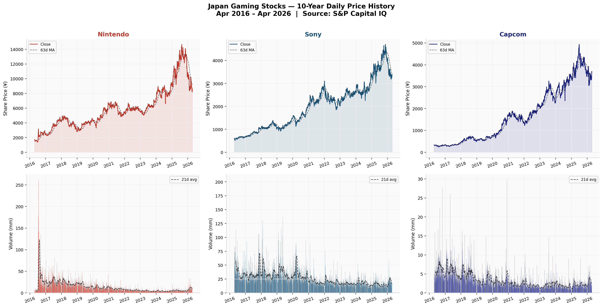
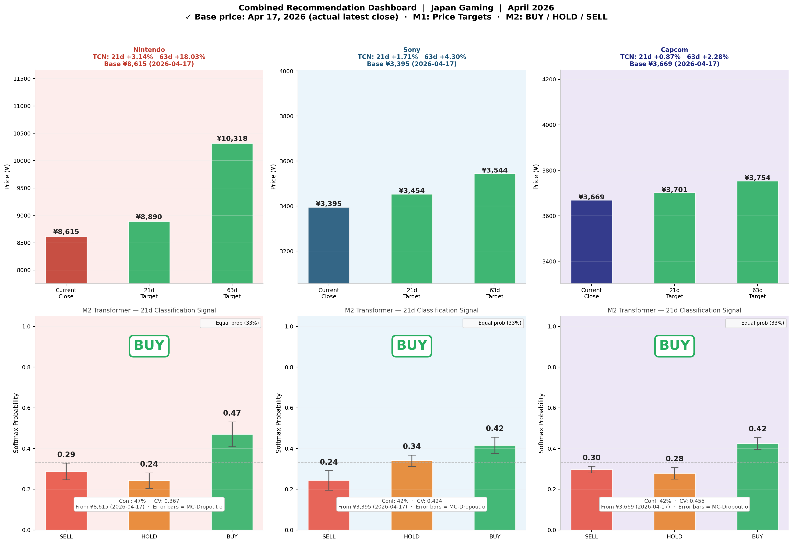
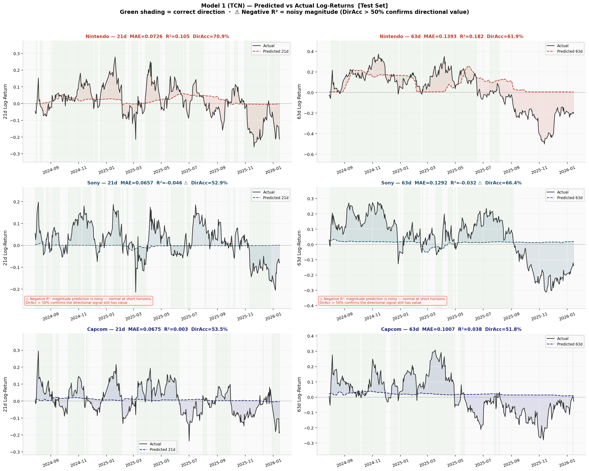
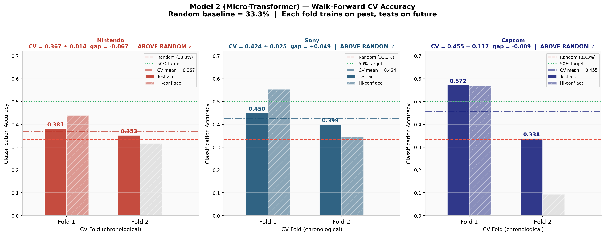

# Japanese Gaming Stock Forecasting

A **FINA2320 Investments and Portfolio Analysis group project** exploring how machine learning can turn historical share prices and trading activity into return forecasts and buy, hold or sell signals.

The project studies **Nintendo, Sony and Capcom** using approximately ten years of daily market data, from April 2016 to April 2026. It covers data preparation, model development, evaluation and a visual dashboard.

[Overview](#what-the-models-do) · [Charts and results](#charts-and-results) · [Run the project](#run-the-project) · [Technical details](#technical-details)

## What the models do

The two models answer different questions:

| Question | Approach | Output |
| --- | --- | --- |
| How much might a share price change? | A temporal convolutional network, which learns patterns in historical sequences | Return forecasts and implied prices for 21 and 63 trading days ahead |
| Is a rise, a fall or a relatively small change more likely? | A Transformer encoder, which learns relationships within a sequence | BUY, HOLD and SELL scores for the next 21 trading days |

Twenty-one trading days is roughly one month; 63 is roughly three months. The classification labels use thresholds corresponding to approximately a 3% rise or fall, with smaller movements labelled HOLD.

The workflow is straightforward: **prepare historical prices and volumes, calculate indicators of market behaviour, train the models, evaluate their predictions, and present the outputs.**

The main script is [`japan_gaming_pipeline_new.py`](japan_gaming_pipeline_new.py). The charts below are **saved outputs from an April 2026 run**, rather than live market updates.

## Charts and results

### 1. Understanding the historical data



The top row shows share prices in Japanese yen; the bottom row shows trading volumes. Dashed lines smooth short-term movements.

The companies share an industry, but their price paths and trading activity differ. Each panel has its own vertical scale, so compare changes over time rather than line heights across companies.

### 2. Combining the forecasts and signals



The dashboard uses closing prices from **17 April 2026**:

- **Top row:** Observed prices alongside the first model's implied prices for 21 and 63 trading days ahead.
- **Bottom row:** The second model's SELL, HOLD and BUY scores. The highest-scoring category becomes the displayed label.

A BUY label can appear with a score below 50%, because it is simply the largest of three scores. The score is not a verified probability of a profitable trade. Error bars show variation across repeated model predictions, not guaranteed bounds on future returns.

### 3. Comparing forecasts with actual outcomes



The **solid black line** shows the return that actually occurred in the test period. The **coloured dashed line** shows the forecast. Positive values represent rises; negative values represent falls. The vertical axis uses log-returns, a mathematical measure of price change.

Some forecasts identify the direction but miss the size of a move. Others remain close to zero while actual returns change substantially.

| Measure in the chart | What it means |
| --- | --- |
| Mean absolute error (MAE) | Average size of the forecast error; smaller is better |
| Coefficient of determination (R²) | How well predictions explain variation in actual returns; negative values indicate performance worse than a constant prediction equal to the test-period average |
| Directional accuracy | How often the predicted and actual returns have the same positive or negative sign |

The saved Sony results have negative R² values. Although some figure annotations describe directional accuracy above 50% as evidence of value, that alone does not establish a useful trading strategy.

### 4. Evaluating buy, hold and sell classifications



Each "fold" is an evaluation period: the model trains on earlier data and is tested on later data. Solid bars show classification accuracy. Hatched bars show accuracy for predictions with above-median model scores; this subset does not consistently perform better.

| Company | Average classification accuracy across the two periods |
| --- | ---: |
| Nintendo | 36.7% |
| Sony | 42.4% |
| Capcom | 45.5% |

The red 33.3% line represents choosing uniformly at random among three labels. Since labels are not equally common, exceeding that line alone is insufficient; results should also be compared with always choosing the most common label.

### What this demonstrates

The project combines financial data analysis, regression, classification and visual communication. It is a **research prototype**: the saved results show both potential patterns and substantial prediction errors. They do not establish a reliable trading strategy.

Further work includes stronger baseline comparisons, more rigorous time-series evaluation and testing after trading costs.

## Run the project

### Requirements

Python 3.10 or 3.11 is recommended. The repository includes the three required comma-separated values (CSV) data files.

### Download and install

```bash
git clone https://github.com/githubrlam/fina2320.git
cd fina2320
python3 -m venv .venv
source .venv/bin/activate
python -m pip install --upgrade pip
pip install numpy pandas scikit-learn matplotlib tensorflow tf-keras
```

Alternatively, use **Code → Download ZIP** on GitHub.

On Windows, create and activate the environment with `py -m venv .venv` and `.\.venv\Scripts\Activate.ps1`, then run the package-installation commands above.

### Check paths and run

Keep the script alongside [`nitendo.csv`](nitendo.csv), [`sony.csv`](sony.csv) and [`capcom.csv`](capcom.csv). The spelling of `nitendo.csv` matches the existing script.

The default settings read inputs and save charts in the current working directory:

```python
DATA_DIR = ""
OUT_DIR = ""
```

Then run:

```bash
python japan_gaming_pipeline_new.py
```

The script trains both models, prints evaluation measures and forecasts, and writes the report images. Rerunning replaces images with the same filenames. Training can take time without a graphics processor.

For another folder, set explicit paths in the script and keep the trailing slash:

```python
DATA_DIR = "/full/path/to/fina2320/"
OUT_DIR = "/full/path/to/results/"
```

## Technical details

<details>
<summary>Model architectures and evaluation</summary>

**Model 1: Temporal convolutional network (TCN) regression**

- Uses a 120-observation look-back window and 23 price/volume-derived features.
- Learns sequential patterns using causal, dilated convolutions.
- Predicts 21- and 63-trading-day forward log-returns through two output heads.
- Evaluates mean absolute error, R² and directional accuracy on a chronological hold-out period.

**Model 2: Transformer encoder classification**

- Uses a 60-observation look-back window, eight features and one Transformer encoder block.
- Predicts three labels over 21 trading days: BUY for a forward log-return of at least 0.03, SELL for at most -0.03, and HOLD otherwise.
- Uses two expanding-window chronological cross-validation (CV) folds, class weighting and regularisation.
- Retrains on all labelled observations for the final forward signal.
- Uses Monte Carlo dropout: repeated predictions with dropout active to show variation in model scores.

Feature scaling is fitted on training data within each evaluation split. Feature-only preparation is separate from target construction so final forecasts use the latest available observations.

The current splits do not include an explicit purge or embargo gap for overlapping forward-return labels. Adding a gap would strengthen evaluation. No transaction-cost-adjusted trading backtest is reported here.

</details>

<details>
<summary>All generated charts</summary>

| File | Contents |
| --- | --- |
| [`rpt_00_pipeline.png`](rpt_00_pipeline.png) | Workflow and architecture |
| [`rpt_m1_01_price_history.png`](rpt_m1_01_price_history.png) | Prices and trading volumes |
| [`rpt_m1_02_predictions.png`](rpt_m1_02_predictions.png) | Predicted versus actual returns |
| [`rpt_m1_03_residuals.png`](rpt_m1_03_residuals.png) | Forecast errors |
| [`rpt_m1_04_loss.png`](rpt_m1_04_loss.png) | Training and validation loss |
| [`rpt_m1_05_forecast.png`](rpt_m1_05_forecast.png) | Forward price forecasts |
| [`rpt_m2_01_cv_accuracy.png`](rpt_m2_01_cv_accuracy.png) | Classification accuracy |
| [`rpt_m2_02_loss_curves.png`](rpt_m2_02_loss_curves.png) | Classifier learning curves |
| [`rpt_m2_03_confusion.png`](rpt_m2_03_confusion.png) | Correct and incorrect labels |
| [`rpt_m2_04_probs.png`](rpt_m2_04_probs.png) | Model scores over time |
| [`rpt_m2_05_dashboard.png`](rpt_m2_05_dashboard.png) | Combined forecast and signal dashboard |

</details>

<details>
<summary>Reproducibility and troubleshooting</summary>

**Results vary between runs.** NumPy and TensorFlow seeds are set, but random initialisation, dropout, training dynamics and hardware can still change results. The committed charts are one saved example.

**TensorFlow installation fails.** The script imports `tf-keras` as `tf_keras`. A version-specific installation to try is:

```bash
pip install "tensorflow==2.16.*" "tf-keras==2.16.*"
```

**Data files cannot be found.** Check filenames, especially `nitendo.csv`, and the current working directory or `DATA_DIR`.

**Training is slow.** Lower `M1_EPOCHS` and `M2_EPOCHS` for a shorter trial. Sony also has an epoch setting in `M2_STOCK_TUNE`; final classifier retraining has a separate 30-epoch setting.

**Save package versions for a run:**

```bash
pip freeze > requirements.txt
```

**Reinstall those versions later:**

```bash
pip install -r requirements.txt
```

</details>
